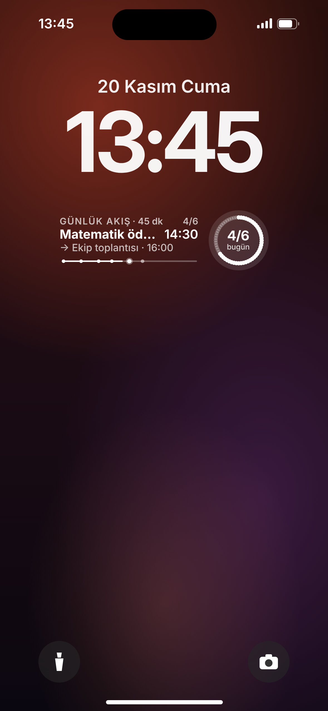
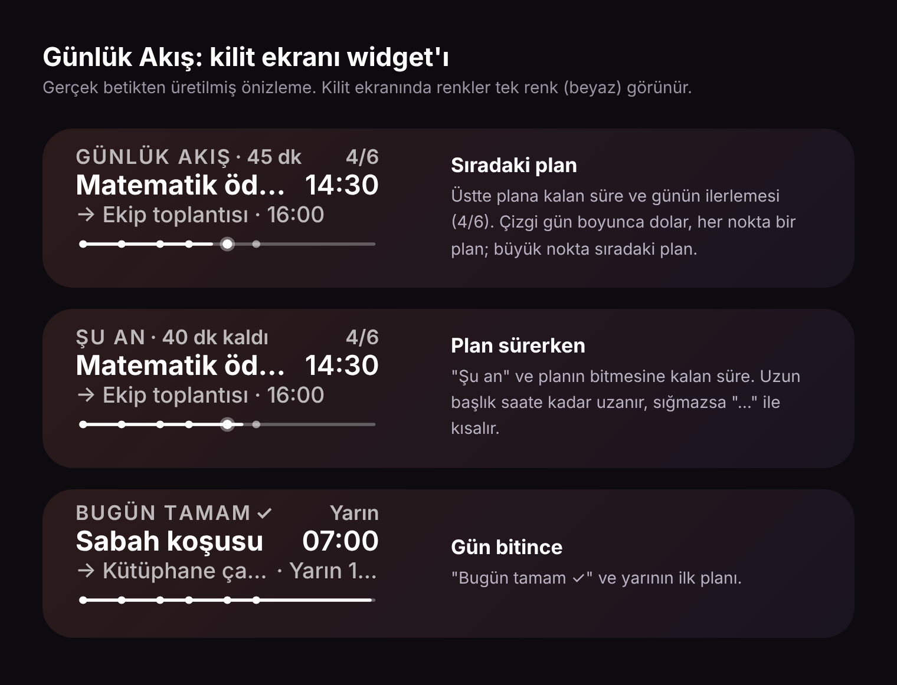

# Kilit ekranına "Günlük Akış" widget'ı

Kilit ekranında günün akışını gösterir:

- **Üst satır:** sıradaki plana kalan süre ve bugün kaç planın bittiği (4/6).
- **Orta satır:** sıradaki planın başlığı ve saati.
- **Alt satır:** ondan sonraki plan.
- **Çizgi:** günün zaman çizelgesi. Her nokta bir plan, şimdiye kadar dolar, büyük nokta sıradaki plan.
- Plan başladıysa üst satır **"Şu an · 20 dk kaldı"** olur.
- O günün planları bittiyse **"Bugün tamam ✓"** yazar ve sıradaki günün ilk planı görünür.
- Sadece **kendi planların** görünür.

Kurulum 5 dakika sürer, her ekip üyesi kendi telefonunda bir kez yapar.

## 1. Scriptable'ı indir

App Store'dan ücretsiz **Scriptable** uygulamasını indir.

## 2. Betiği ekle

1. iPhone'da Safari ile bu adresi aç:
   https://raw.githubusercontent.com/samiltalha/haftalik-plan/main/widget/haftalik-plan-widget.js
2. Sayfadaki yazıya uzun bas, **Tümünü Seç**, sonra **Kopyala**.
3. Scriptable'ı aç, sağ üstteki **+** ile yeni betik oluştur, kopyaladığını yapıştır.
4. Üstteki başlığa dokunup adını **Günlük Akış** yap, **Bitti** de.

## 3. Bir kez çalıştırıp giriş yap

1. Betiği açıkken sağ alttaki **▶︎** düğmesine bas.
2. Haftalık Plan uygulamasında kullandığın **e-posta ve şifreyi** gir.
3. Açılan menüden **"Önizle: kilit ekranı"** ile nasıl görüneceğine bakabilirsin.

Şifren sadece senin telefonunun Anahtar Zinciri'nde saklanır, kimseye gönderilmez.

## 4. Kilit ekranına ekle

1. Kilit ekranına uzun bas, **Özelleştir**, sonra **Kilit Ekranı**'na dokun.
2. Saatin altındaki widget alanına dokun, listeden **Scriptable**'ı seç.
3. **Geniş (dikdörtgen)** olanı ekle.
4. Eklediğin widget'a bir kez daha dokun, **Script** kısmından **Günlük Akış**'ı seç.
5. Sağ üstten **Bitti**.

İstersen kilit ekranına yuvarlak olanı da ekleyip aynı betiği seçebilirsin: bugünkü ilerlemeyi (4/6) halka olarak gösterir. Ana ekrana da küçük ya da orta boy Scriptable widget'ı ekleyebilirsin: orada sıradaki birkaç plan renkli listelenir.

## İsteğe bağlı ayarlar

Widget'ı düzenlerken **Parameter** kutusuna yazabilirsin (boşlukla birden fazla):

| Yazı | Ne yapar |
|---|---|
| `ekip` | Ekibin paylaştığı planlar da görünür |
| `canli` | "45 dk" yerine saniye saniye işleyen canlı sayaç (`44:12`) |

Hesap değiştirmek ya da çıkış yapmak için betiği Scriptable'da tekrar **▶︎** ile çalıştır.

## Bilmen gerekenler

- **Uzun başlıklar kaymaz.** iOS, kilit ekranı widget'larında kayan yazıya ve animasyona izin vermiyor. Başlık, saate kadar olan yeri doldurur ve sığmazsa "…" ile kısalır.
- **Ne sıklıkla yenilenir?** Bunu iOS belirler, genelde 5 ile 15 dakikada bir. Bu yüzden "45 dk" yazısı birkaç dakika geriden gelebilir. Tam doğru sayaç istersen `canli` parametresini kullan.
- **İnternet yoksa** widget son bildiği planları gösterir ve ikon bulut-çizgi olur.
- Widget'a dokununca Haftalık Plan uygulaması açılır.
